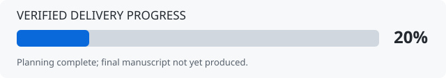

# سمینار رابطه شخصیت و خودکشی

**مقطع:** کارشناسی ارشد روان‌شناسی شخصیت — **زبان:** فارسی — **هدف نهایی:** Word قابل‌ویرایش در حدود ۳۰ صفحه.

> **وضعیت واقعی: پرامپت، برنامه و پژوهش مقدماتی ثبت شده‌اند؛ سمینار نهایی هنوز آماده نیست.**
> تاریخ وضعیت: ۲۰۲۶-۱۰-۱۳ | checkpoint: `CP03-initial-research` | پیشرفت وزنی تحویل: **۲۵٪**.

## پیشرفت پروژه



```text
کل پروژه   [█████░░░░░░░░░░░░░░░] 25%
```

| مرحله | وزن از کل | امتیاز کسب‌شده | وضعیت |
|---|---:|---:|---|
| ۱. پرامپت جامع و تثبیت دامنه | ۱۰ | ۱۰ | انجام‌شده |
| ۲. ساختار، برنامه و راهنمای ادامه | ۱۰ | ۱۰ | انجام‌شده |
| ۳. جست‌وجو، تأیید و استخراج منابع | ۲۰ | ۵ | پژوهش اولیه؛ ادامه لازم است |
| ۴. نگارش و تلفیق بخش‌های سمینار | ۲۰ | ۰ | شروع نشده |
| ۵. نقد تفصیلی سه مقاله | ۲۰ | ۰ | شروع نشده |
| ۶. جدول‌ها و نمودارهای مستند | ۵ | ۰ | شروع نشده |
| ۷. ساخت و صفحه‌آرایی Word/PDF | ۱۰ | ۰ | شروع نشده |
| ۸. بازبینی نهایی و تحویل | ۵ | ۰ | شروع نشده |
| **مجموع** | **۱۰۰** | **۲۵** | **نسخه علمی نهایی موجود نیست** |

درصد، شاخص مدیریت خروجی‌های قابل‌بررسی است؛ نه درصد صحت علمی، نه درصد متن نوشته‌شده و نه تضمین آماده‌بودن ارائه. مبنای عددها در [PROGRESS.json](docs/PROGRESS.json) و معیار هر مرحله در [برنامه اجرایی](docs/PLAN.fa.md) ثبت شده است. از مرحله منابع فقط دروازه P3.1 امتیاز گرفته؛ جست‌وجوی کامل و نقد مقاله‌ها تکمیل نشده‌اند. نمودار این صفحه علمی نیست و در شمار شکل‌های سمینار قرار نمی‌گیرد.

## فایل‌های اصلی

**خواسته‌های کامل:** [پرامپت جامع فارسی](MASTER_PROMPT.fa.md)

**ادامه کار:** [وضعیت دقیق و قدم بعدی](PROJECT_STATUS.md) · [راهنمای ایجنت‌ها](AGENTS.md) · [تاریخچه کار](WORK_LOG.md)

**پژوهش:** [پروتکل مرور](research/SEARCH_PROTOCOL.md) · [دفتر جست‌وجو و محدودیت‌ها](research/SEARCH_LOG.md) · [منابع و سطح دسترسی](research/SOURCE_LEDGER.md)

**کنترل و خروجی:** [چک‌لیست تمام الزامات](qa/REQUIREMENTS_CHECKLIST.md) · [وضعیت متن](manuscript/README.md) · [وضعیت فایل تحویلی](artifacts/README.md)

## آنچه اکنون انجام شده است

پرامپت با تمام جزئیات ارسالی کاربر یکپارچه شده؛ برنامه هشت‌مرحله‌ای، بودجه پیشنهادی ۳۰ صفحه و راهنمای تداوم ثبت شده‌اند. دفتر پژوهش شامل سه نامزد اولیه برای نقد، یک منبع جدیدتر و یک منبع فارسی است؛ دسترسی چکیده با خواندن کامل یکسان ثبت نشده است. استخراج اولیه چند برآورد یک مقاله نیز با منشأ در CSV موجود است؛ هنوز نمودار علمی یا نقد نهایی از آن ساخته نشده است.

## محدوده خروجی

ساختار یازده‌بخشی مطابق درخواست کاربر، تحلیل مستقل سه مقاله، حداقل شش جدول، مدل مفهومی مستند و نمودار کمی فقط با داده معتبر و قابل‌مقایسه؛ منابع فارسی و انگلیسیِ تأییدشده، APA 7، فهرست‌های قابل‌به‌روزرسانی و صفحه‌آرایی راست‌به‌چپ.

نگارش مستقل و ارجاع صحیح لازم است؛ هیچ وعده «صفر درصد همانندجویی» داده نمی‌شود. نام تهیه‌کننده و دانشگاه از نام مخزن حدس زده نمی‌شود.

## گام بعدی ثبت‌شده

گسترش جست‌وجوی منابع، دسترسی و استخراج کامل مقاله‌ها و تصمیم نهایی درباره سه نقد؛ سپس نگارش بخش‌های دارای شواهد. دستور دقیق در `PROJECT_STATUS.md` است. هر ایجنت ابتدا `AGENTS.md` و آخرین checkpoint را بخواند و از صفر شروع نکند.

## فایل نهایی

**هنوز تولید نشده است.** فایل Word، PDF و شمار صفحات تأییدشده فقط پس از ساخت و بازبینی در این قسمت معرفی خواهند شد. پرامپت و فایل‌های برنامه‌ریزی جایگزین سمینار نیستند.

مخزن عمومی است. اطلاعات شخصی، رمز، توکن، فونت دارای محدودیت مجوز و متن کامل مقالات بدون مجوز بازنشر نباید در آن قرار گیرد.
